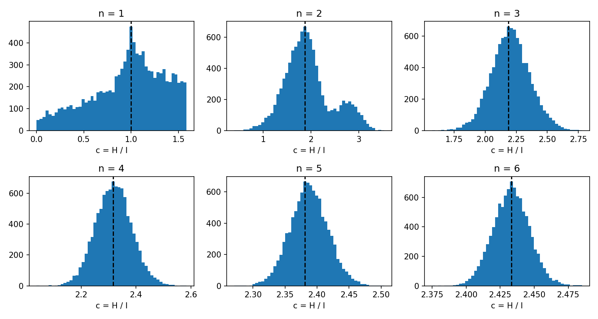
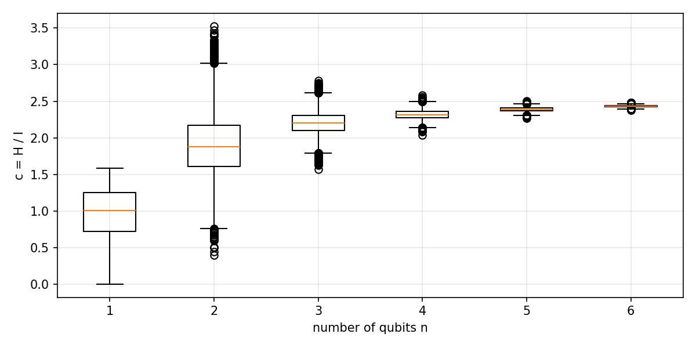

Quantum Fourier entropy-influence conjecture
============================================

This tutorial shows how to use :code:`paulie` to compute the quantum Fourier entropy and the
influence of an operator, and to test the quantum Fourier entropy-influence (QFEI) conjecture
numerically.

Entropy and influence
---------------------

Every operator :math:`O` acting on :math:`n` qubits can be written as a linear combination of Pauli
strings,

.. math::
    O = \sum_{P \in \{I,X,Y,Z\}^{\otimes n}} c_P\, P, \qquad c_P \in \mathbb{C}.

The *weight* :math:`|P|` of a Pauli string is the number of non-identity terms, e.g.
:math:`|XIZ| = 2` and :math:`|YII| = 1`. For a Hermitian :math:`O` with :math:`O^2 = I` the
coefficients satisfy :math:`\sum_P |c_P|^2 = 1`. Two quantities are defined from them:

* the **quantum Fourier entropy**, which measures how many Pauli strings the operator is spread over,

  .. math::
      H(O) = -\sum_P |c_P|^2 \log_2 |c_P|^2 ,

* the **influence** (average Pauli weight), which measures how non-local the operator is,

  .. math::
      I(O) = \sum_P |P|\, |c_P|^2 .

The conjecture
--------------

The conjecture states that there is a universal constant :math:`c` such that

.. math::
    H(O) \le c\, I(O)

for every Hermitian :math:`O` with :math:`O^2 = I` except :math:`O = \pm I`, on any number of qubits
:math:`n`. Equivalently, :math:`c` must be at least the largest ratio :math:`H(O)/I(O)`.

Entropy and influence of an operator
------------------------------------

:code:`quantum_fourier_entropy` and :code:`average_pauli_weight` take the operator matrix and return
:math:`H(O)` and :math:`I(O)`. As an example we take :math:`O = \sqrt{0.3}\, XIZ + \sqrt{0.7}\, YII`,
which satisfies :math:`O^2 = I` because the two Pauli strings anticommute.

.. code-block:: python

    from paulie import PauliString, PauliStringLinear
    from paulie import average_pauli_weight, quantum_fourier_entropy

    a, b = PauliString(pauli_str="XIZ"), PauliString(pauli_str="YII")
    O = PauliStringLinear([(0.3**0.5, a), (0.7**0.5, b)]).get_matrix()
    H = quantum_fourier_entropy(O)
    I = average_pauli_weight(O)
    print(f"H = {H:.4f}, I = {I:.4f}, H/I = {H / I:.4f}")

Outputs:

.. code-block:: bash

    H = 0.8813, I = 1.3000, H/I = 0.6779

This agrees with :math:`H = -0.3 \log_2 0.3 - 0.7 \log_2 0.7 \approx 0.881` and
:math:`I = 0.3 \cdot 2 + 0.7 \cdot 1 = 1.3`.

Random involutions
------------------

To study the ratio for many operators, we build random involutions. We start from a random
Hermitian operator made of all :math:`4^n` Pauli strings,

.. math::
    G = \sum_P g_P\, P, \qquad g_P \sim \mathcal{N}(0, 1),

and replace each of its eigenvalues by its sign,

.. math::
    O = \operatorname{sign}(G) = U D U^\dagger, \qquad D = \operatorname{diag}(\pm 1).

Every entry of :math:`D` is :math:`+1` or :math:`-1`, so :math:`D^2 = I` and therefore
:math:`O^2 = U D^2 U^\dagger = I`. The random operators are obtained in this way, except when
:math:`O = \pm I`.

Procedure
~~~~~~~~~

The numerical experiment can be done in a few steps:

1. Loop over the number of qubits :math:`n`
2. Generate all :math:`4^n` Pauli strings
3. Build a random involution :math:`O`
4. Compute the influence :math:`I(O)`
5. Compute the entropy :math:`H(O)`
6. Compute the ratio :math:`H(O)/I(O)`

With :code:`paulie` this takes only a few lines:

.. code-block:: python

    import numpy as np
    from paulie import average_pauli_weight, quantum_fourier_entropy
    from paulie import PauliStringLinear as pl
    from paulie.common.pauli_string_factory import gen_all_pauli_strings

    def random_involution(rng, all_pauli_n, n):
        """Random Hermitian O with O^2 = I, built from all Pauli strings.

        G = sum_P gP * P            with random real gP ~ Normal(0, 1)
        O = sign(G) = sum_P cP * P  sign applied to the eigenvalues of G
        """
        d = 2 ** n
        while True:
            # random Hermitian operator: linear combination of all Pauli strings
            rand_gp = rng.normal(size=len(all_pauli_n))
            rand_opt = pl([(float(gp), P) for gp, P in zip(rand_gp, all_pauli_n)]).get_matrix()
            # make it an involution: replace every eigenvalue by its sign (+1 or -1)
            eigval, eigvec = np.linalg.eigh(rand_opt)
            signs = np.sign(eigval)
            if abs(signs.sum()) < d:          # skip O = +-I
                return (eigvec * signs) @ eigvec.conj().T

    N_MAX = 6          # largest number of qubits
    TRIALS = 10000     # random operators per n
    BINS = 50          # histogram bins
    rng = np.random.default_rng(2025)

    for n in range(1, N_MAX + 1):                                 # 1. loop over n
        all_pauli_n = list(gen_all_pauli_strings(n))              # 2. all 4^n Pauli strings
        c_values = []
        for _ in range(TRIALS):
            O = random_involution(rng, all_pauli_n, n)            # 3. random O with O^2 = I
            I = average_pauli_weight(O)                           # 4. influence
            H = quantum_fourier_entropy(O)                        # 5. entropy
            c_values.append(H / I)                                # 6. ratio

        c_values = np.array(c_values)
        counts, edges = np.histogram(c_values, bins=BINS)
        k = np.argmax(counts)
        most_frequent = (edges[k] + edges[k + 1]) / 2
        print(f"n = {n}: min {c_values.min():.4f}, max {c_values.max():.4f}, "
              f"most frequent {most_frequent:.4f}")

Outputs:

.. code-block:: bash

    n = 1: min 0.0015, max 1.5849, most frequent 0.9990
    n = 2: min 0.3969, max 3.5280, most frequent 1.8685
    n = 3: min 1.5718, max 2.7791, most frequent 2.1875
    n = 4: min 2.0379, max 2.5838, most frequent 2.3163
    n = 5: min 2.2710, max 2.5048, most frequent 2.3809
    n = 6: min 2.3749, max 2.4851, most frequent 2.4333

The histograms show the distribution of the ratio for each :math:`n`; the dashed line marks the most
frequent value.

The box plots show how the spread of the ratio shrinks with :math:`n`.

Conclusion
----------

With :code:`paulie` we computed the influence :math:`I(O)` and the quantum Fourier entropy
:math:`H(O)` of random operators :math:`O` and obtained the statistical distribution of the ratio

.. math::
    c = \frac{H(O)}{I(O)}.

The key findings are:

* for each :math:`n` there is an empirical lower and upper bound on the ratio,
* the more qubits are used, the smaller the range of the ratio,
* the most frequent ratio increases with :math:`n` and appears to approach :math:`\approx 2.5`.